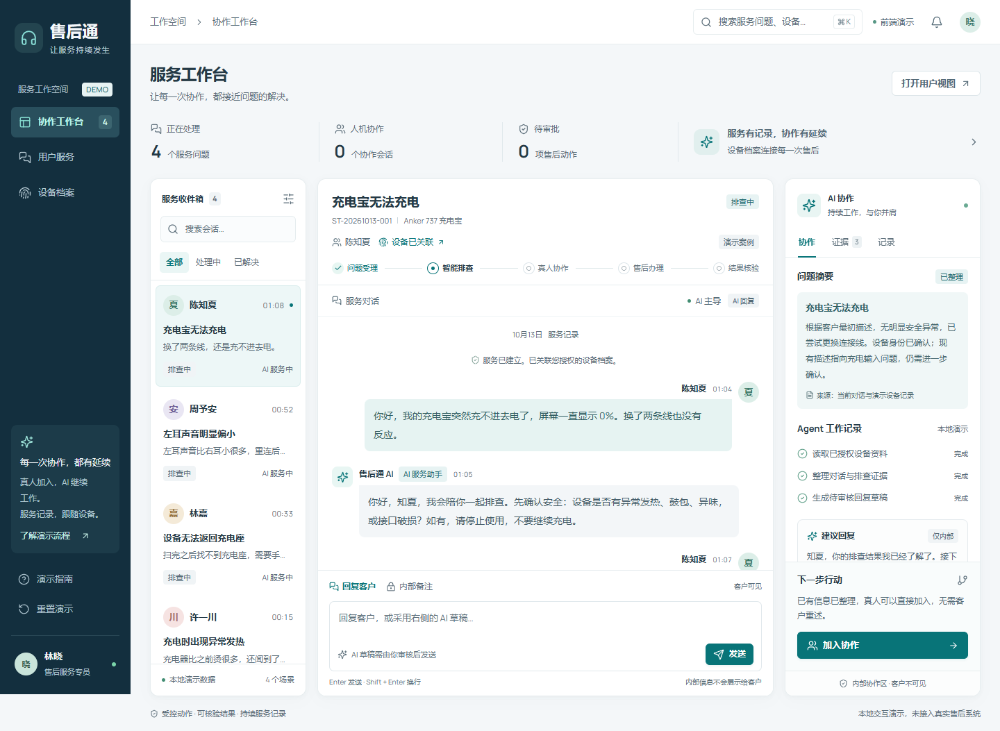

# 售后通 · 前端演示

面向智能硬件售后的持续服务工作台。围绕同一个服务问题，把用户报障、AI 排查、真人协作、审批、模拟换新和结果核验串成可操作的前端演示。

**React 19 · TypeScript · Vite · React Router · Lucide**



## 快速运行

准备 Node.js 24 和 npm，然后在终端执行：

```sh
git clone https://github.com/Felicitate555/shouhoutong-frontend.git
cd shouhoutong-frontend
npm ci
npm run dev
```

浏览器打开 **http://127.0.0.1:5173/**。仓库链接用来查看和下载源码；本地启动后才能体验交互页面。

## 三个角色页面

| 页面 | 功能 |
| --- | --- |
| `/desk` | 客服工作台：收件箱、消息、内部备注、AI 草稿、证据、协作记录、审批及模拟执行 |
| `/support?case=c1` | 用户服务：报障、图片上传、排查反馈、申请真人、确认是否解决 |
| `/devices/demo-737` | 设备档案：已核实事实、来源、服务历史、最新核验结果 |

提供充电宝、耳机、扫地机器人和充电器四个示例场景。桌面采用三栏协作布局，手机通过收件箱、对话和 AI 协作页签操作。

## 体验完整闭环

1. 在用户服务中点击「已排查，仍未恢复」，可上传不超过 2 MB 的 JPG、PNG 或 WebP 图片。
2. 申请真人协助，再切换到客服工作台点击「加入协作」。
3. 点击「采用草稿」，审核后发送。可切换到「内部备注」，记录仅客服视图展示的信息。
4. 提出模拟换新方案，选择批准或拒绝；批准本身不会执行动作。
5. 点击「执行模拟换新」，生成带 `DEMO-` 前缀的本地回执。
6. 回到用户服务确认结果。已解决时关联到设备历史；仍未解决则继续服务。

提交后的消息与进度保存在当前浏览器中。使用「重置演示」恢复初始数据；桌面支持 Ctrl/⌘ + K 搜索。

## 开发与验证

```sh
npm test                  # 业务状态与边界测试
npm run build             # TypeScript 检查与生产构建
npm run preview           # 预览生产产物
npx playwright test       # 浏览器流程与无障碍自动扫描
```

浏览器测试使用本机 Chrome，运行前先启动 `npm run dev`。测试覆盖完整业务闭环、审批与执行分离、内部信息过滤、刷新恢复、搜索与重置、手机布局，以及共同服务/真人主导模式下的安全报告处理。

## 前端边界

- 这是纯前端本地模拟，未连接 LLM、API、数据库、物流或真实 Anker 售后系统。
- AI 回复和协作建议使用有限本地脚本；不会实际换新、发货、付款或扣款。
- 用户和客服是可以主动切换的演示视图，没有生产认证或后端资源授权。
- 设备插图为自绘示意图，示例人物和服务记录为演示数据。
- 字体本地加载，Manrope 的 OFL 许可保存在 `public/fonts/LICENSE-Manrope.txt`。

## 项目结构

```text
src/components/   共享导航、对话、输入框、收件箱和 AI 协作面板
src/pages/        客服、用户与设备档案页面
src/domain/       演示数据、类型、状态迁移、持久化和业务测试
src/styles.css    颜色、排版、布局、状态及响应式设计
public/           设备示意图、图标和本地字体
e2e/              Playwright 流程与 Axe 无障碍测试
```

生产静态文件输出到 `dist/`。部署时需要将未知路由回退到 `index.html`，以支持页面深链接。
